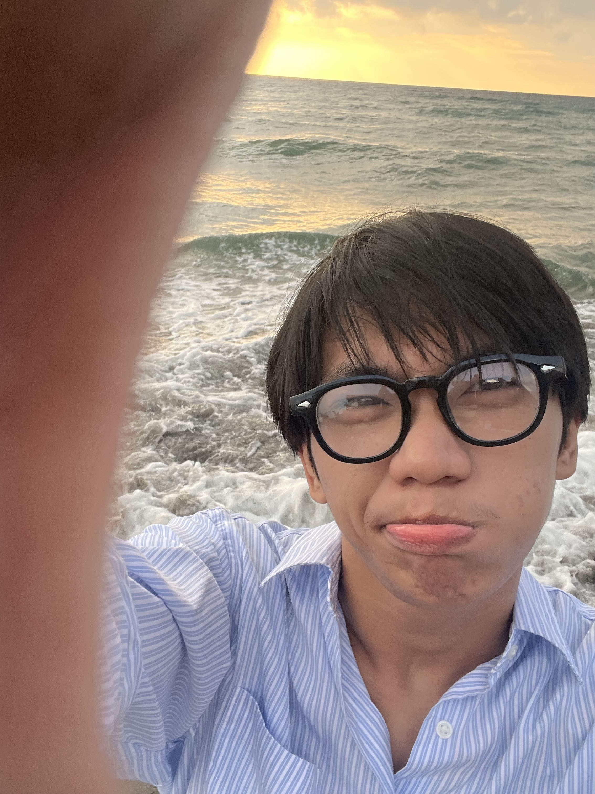
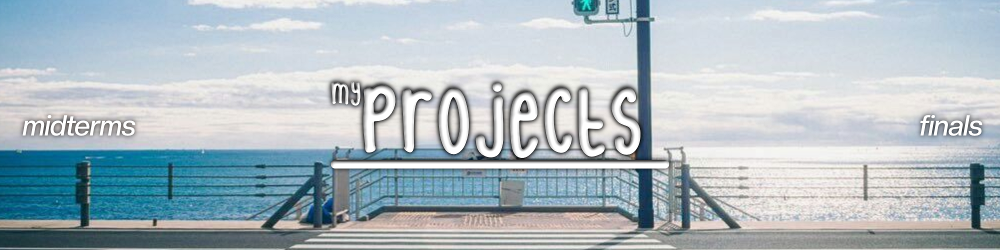
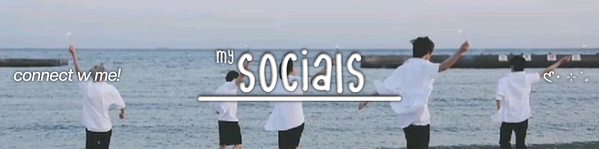

<!-- p = wrap text, h3 = medium sized, h2 - primary subheading, h1 = main page title -->

  

<!-- h2 = heading2 -->
<h2 align="center">───────────────── ⊹ ࣪ ──── °‧ 𓆝 𓆟 𓆞 ·｡ ──── ⊹ ࣪ ˖ ─────────────────</h2>

<!-- about me -->
<table width="100%">
  <tr>
    <td width="20%" align="left">
      
    </td>
    <td width="80%" align="left">
      

        
      

      
Helloo! I'm Julian Crelle M. Aguilar from the section ITE104, under BSIT program at National University Clark. I like listening to music (<a href="https://open.spotify.com/playlist/5oLeVSiLNWo4pSD7nQ1mld?si=5u0zqFDpQciJ1egGf4kqpg">K-pop</a>, <a href="https://open.spotify.com/playlist/4WE92XgsYZB8JweCtQJ491?si=f23832258a644ab2&pt=8f2721081d629a22461980f4f7535f99">Pop</a>, and <a href="https://open.spotify.com/playlist/7o0jcczN1Nk9baCubTgrBi?si=7zhCdBPMRYKzLYARqveQDQ">OPM</a>), playing online games (<a href="https://www.roblox.com/games/185655149/Welcome-to-Bloxburg">Welcome to Bloxburg</a>, <a href="https://www.roblox.com/games/15101393044/Dress-To-Impress">Dress To Impress</a>, and <a href="https://genshin.hoyoverse.com/en/">Genshin Impact</a>), and I also enjoy watching 2000s romcom movies, watching K-dramas, and pageantries.

    </td>
  </tr>
</table>

<!-- creative skills -->
<table width="100%">
  <tr>
    <td width="20%" align="center" valign="middle">
      
    </td>
    <td width="60%" align="center" valign="top">
      

        
      

      

        <b>Pubmat Editing & Design</b> 
        <b>Filming & Videography</b> 
        <b>Film & Video Editing</b>
      

      
    </td>
    <td width="20%" align="center" valign="middle">
      
    </td>
  </tr>
</table>

  

<!-- h2 = heading2 -->
<h2 align="center">─────────────── ⊹ ࣪ ──── 🌊｡𖦹°.🐚⋆°🫧 ──── ⊹ ࣪ ˖ ───────────────</h2>

<table width="100%">
  <tr>
    <td width="50%" align="center" valign="top">
        
      
      

        <a href="MIDTERMS LAB TASK/Aguilar - Term 2 - Midterms Lab Task 1.pdf"> • Lab Task 1 - Using 2 Dimensional Array</a> 
        <a href="MIDTERMS LAB TASK/Aguilar - Term 2 - Midterms Lab Task 2.pdf"> • Lab Task 2 - Using 3 Dimensional Array</a> 
      

    </td>
    <td width="50%" align="center" valign="top">
        
      
      

        <a href="FINAL_FILE_1_LINK"> • Placeholder for Finals Lab Task </a> 
        <a href="FINAL_FILE_2_LINK"> • Placeholder for Finals Lab Task</a>
      

    </td>
  </tr>
</table>

  

<!-- h2 = heading2 -->
<h2 align="center">─────────────── ⊹ ࣪ ──── °:•.🐠*.•🪸.•:° ──── ⊹ ࣪ ˖ ───────────────</h2>

<!-- socials -->
<table width="100%">
  <tr>
    <td align="center" valign="middle">
      
      

        
       &nbsp;&nbsp;
        
      &nbsp;&nbsp;
        
       &nbsp;&nbsp;
        
      

      
    </td>
  </tr>
</table>
