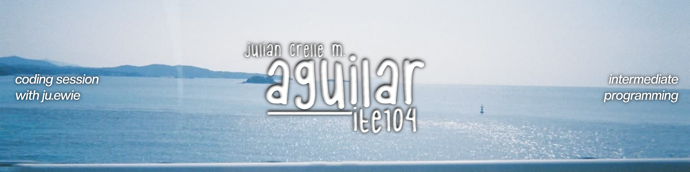

<!-- p = wrap text, h3 = medium sized, h2 - primary subheading, h1 = main page title
-->

 

<!-- h2 = heading2 -->
<h2 align="center">───────────────── ⊹ ࣪ ──── °‧ 𓆝 𓆟 𓆞 ·｡ ──── ⊹ ࣪ ˖ ─────────────────</h2>

<!-- about me -->
<!-- table = table grid, tr = table row, td = table data, image src ="..." putting image, width = "% or no. is width of image, h3 = header3, align = horizontal align, valign = vertical align, ul = unordered list, li = list item -->
<table>
  <tr>
    <td width="24%" align="left">
      
    </td>
    <td width="80%" valign="top">
      <h3>₊˚⊹🪼 About Me</h3>
      
Helloo! I'm Julian Crelle M. Aguilar, a student of the class ITE104 from the program of BSIT. I'm a person who personally likes listening to music, playing online games, and watching movies.

      <ul>
        <li>First point</li>
        <li>Second point</li>
      </ul>
    </td>
  </tr>
</table>

